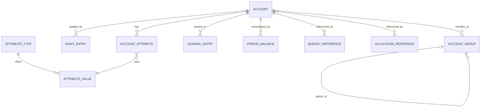
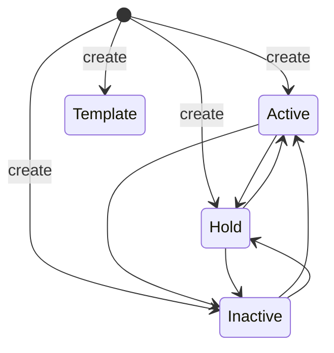

# Data Model: GL Account Maintenance and Inquiry

Conceptual model derived from the approved spec. It is not a database schema: the data layer is in-memory
stub data (Q-014). Types are descriptive; exact JSON shapes are fixed in the OpenAPI contract (Step 4).

## Entities owned by this feature

### Account

| Field | Type | Rules | Mutable after create | Source |
|---|---|---|---|---|
| accountId | string, <= 32 chars | Full Account ID, e.g. `1000-100-01`; unique; must parse to the seeded segment format (4-3-2 digits joined by hyphens) and each segment must be in its value list | No | REQ-GLA-001..004 |
| segments | ordered list of (name, value) | Derived by splitting accountId; returned on reads | No | REQ-GLA-002, 005 |
| description | string, 1..200 | Required | Yes | REQ-GLA-006, 007 |
| accountType | `Financial` or `Statistical` | Required | No | REQ-GLA-004, 008 |
| category | `Asset`, `Liability`, `Equity`, `Revenue`, `Expense` for Financial; `Statistical` for Statistical | Required; must match accountType | Yes | REQ-GLA-006, 008, Q-003, Q-018 |
| currencyId | `USD`, `EUR`, `GBP`, `JPY` | Required; change always allowed | Yes | REQ-GLA-006, 007, Q-011 |
| status | `Active`, `Hold`, `Inactive`, `Template` | Required; see state transitions | Yes (not to or from Template) | REQ-GLA-013, 014 |
| balanceType | `BalanceForward` or `Periodic` | Required for Financial; not allowed for Statistical | See rule | REQ-GLA-008, Q-018 |
| normalBalance | `Debit` or `Credit` | Required for Financial; not allowed for Statistical | See rule | REQ-GLA-008, Q-018 |
| createdDate | date | Set by the system | No | PRD table, REQ-GLA-030 |
| version | opaque token | Changes on every successful update; exposed as `ETag` | System | REQ-GLA-035 |
| eligibleForPosting | boolean, derived | True only when status is `Active` | Derived | REQ-GLA-013 |
| attributes | list of AccountAttribute | Zero or more | Yes | REQ-GLA-009 |

Balance Type and Normal Balance are editable only for Financial accounts. The spec lists only Description,
Category, Currency ID and Status as editable (REQ-GLA-006), so Balance Type and Normal Balance are set at
creation and are not part of the update body. The contract stage confirms this; if an update of those two
fields is wanted it is a spec change.

### AccountAttribute

| Field | Type | Rules |
|---|---|---|
| attributeId | string | Assigned by the system, unique within the account |
| attributeTypeId | string | Must exist in the attribute catalog |
| attributeValueId | string | Must exist and belong to attributeTypeId |

An account may have several attributes. Attributes never affect posting eligibility (REQ-GLA-012).

### AuditEntry (append-only, no public read)

| Field | Type | Notes |
|---|---|---|
| auditId | string | System-assigned |
| accountId | string | Subject account |
| kind | `Created`, `FieldChanged`, `StatusChanged`, `AttributeAdded`, `AttributeChanged`, `AttributeRemoved` | REQ-GLA-030, 031 |
| userId | string | From `X-User-Id`; `unknown` if absent (A-008); not verified |
| timestamp | UTC date-time | System clock |
| field, before, after | strings | For `FieldChanged` and attribute changes |
| justification | string, 1..500 | Required for `StatusChanged` |

Entries are never modified or deleted by this feature (NFR-GLA-007).

## Reference data owned by other modules (read-only stubs, Q-008)

| Entity | Used for | Key fields | Requirement |
|---|---|---|---|
| SegmentFormat and SegmentValue lists | Validating and splitting accountId | segment order, length, separator, allowed values | REQ-GLA-002 |
| AttributeType, AttributeValue | Validating attributes | type id and name; value id, name, owning type | REQ-GLA-010 |
| Currency | Validating currencyId | code | REQ-GLA-007 |
| AccountGroup membership | Group list, delete blockers | groupId, name, parentGroupId, contains accountId | REQ-GLA-015, 024 |
| JournalEntry | Transaction history, delete blockers | entryId, accountId, batchId, description, amount, postingStatus (`Posted` or `Unposted`), postingDate, fiscalPeriod | REQ-GLA-020..024 |
| BudgetReference, AllocationReference | Delete blockers | accountId, referencing id | REQ-GLA-024 |
| PeriodBalance | Period summary | accountId, fiscalYear, fiscalPeriod, balance, budgetVersion (optional) | REQ-GLA-017 |

The delete-blocker view is one aggregate: counts of posted transactions, unposted transactions, budgets,
allocations and group memberships for an account. In the stub, counts are precomputed so the check stays fast
for an account with 10,001 entries.

## Relationships

## Validation rules (create and update)

| Rule | Applies to | Requirement | Error behaviour |
|---|---|---|---|
| accountId splits into 3 numeric segments of length 4, 3, 2 joined by `-`, total <= 32 | create | REQ-GLA-002 | 400, "Account ID does not match segment format. Expected format: {format}", each bad segment identified |
| every segment is in its value list | create | REQ-GLA-002 | 400, same message, segment named |
| accountId not already present | create | REQ-GLA-003 | 409, "Account ID '{id}' already exists. Please use a unique ID." |
| description present, 1..200 chars | create, update | REQ-GLA-007 | 400, field error |
| accountType in {Financial, Statistical} | create | REQ-GLA-008 | 400 |
| category valid for accountType | create, update | REQ-GLA-008, Q-003, Q-018 | 400 naming category and allowed list |
| Financial: balanceType and normalBalance present and allowed; Statistical: both absent | create | REQ-GLA-008, Q-018 | 400 field errors |
| currencyId in {USD, EUR, GBP, JPY} | create, update | REQ-GLA-007, Q-011 | 400 |
| accountId or accountType differs from stored value | update | REQ-GLA-004 | 400 naming the permanent field, nothing changed |
| status change has justification 1..500 chars | update | REQ-GLA-014, Q-005 | 400 |
| status change is allowed | update | REQ-GLA-014, Q-004 | 400 |
| If-Match matches current version | update | REQ-GLA-035 | 409, stored account unchanged |
| attribute value belongs to attribute type | create, update, attribute operations | REQ-GLA-010 | 400 field error |

## State transitions (status)

- Active, Hold and Inactive move freely among each other (Q-004). Each change needs a justification (Q-005).
- Template is set only at creation and never changes to or from another status (REQ-GLA-014, AC-GLA-023).
- Posting eligibility: Active only. Hold, Inactive and Template are not eligible (REQ-GLA-013).

## Deletion rule

An account can be deleted only when all five blocker counts are zero (REQ-GLA-024, 025). When blocked, the
response lists every non-zero blocker with its count and suggests deactivation (REQ-GLA-026, BR-GLA-011).
