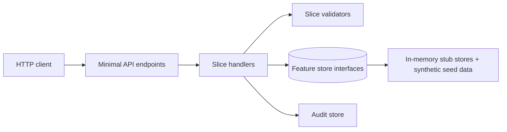

# Implementation Plan: GL Account Maintenance and Inquiry

**Feature directory**: `specs/001-gl-account-maintenance` | **Date**: 2026-10-13 | **Spec**: [spec.md](spec.md)

**Input**: Approved specification (35 requirements REQ-GLA-001..035, 53 active acceptance criteria, 8 NFRs) with clarifications Q-001..Q-018 resolved.

## Summary

Deliver GL account create, read, update, delete, classification, status, attributes, templates, group
membership, period summary and transaction inquiry as a REST service. The service is built as vertical
slices on ASP.NET Core 10 minimal APIs, backed only by deterministic in-memory stub data behind small
feature-specific store interfaces. The API is designed first (OpenAPI, design-time-first policy, ADR-001)
and the implementation must conform to it. No authentication or authorization is built (Q-001), and no UI is
built in this plan (frontend ADR-002 is still undecided; see Open decisions).

## Technical Context

**Language/Version**: C# on .NET 10 (`net10.0`); SDK 10.0.401 is installed (repository baseline).

**Primary Dependencies**: ASP.NET Core 10 (minimal APIs, built-in `Microsoft.AspNetCore.OpenApi`); ClosedXML (MIT) for the single `.xlsx` export. No FluentValidation, MediatR, ORM or generic repository (see research.md).

**Storage**: None. In-memory, thread-safe stub stores seeded with synthetic data (`AGENTS.md`, `.bob/instructions/dotnet.md` Stub data). Durability, transactions and migrations are "not verified (stub data)".

**Testing**: xUnit; `WebApplicationFactory<Program>` for integration and contract-conformance tests; Playwright only after a frontend exists.

**Target Platform**: Windows/Linux server process (Kestrel). Local and non-production use only, because there is no authentication or authorization (Q-001).

**Project Type**: Web service (API only in this plan).

**Performance Goals**: NFR-GLA-001..005 (create <= 2 s; read, update, attribute operations and deletion dependency check <= 1 s), measured against stub data only.

**Constraints**: Stub data only; no auth; no real database; OpenAPI is authoritative (design-time first); one nullable-enabled, warnings-as-errors build.

**Scale/Scope**: 16 API operations, 9 vertical slices plus one foundation task, about 53 acceptance criteria. One seeded account carries 10,001 posted transactions to prove paging and the fast dependency check.

## Constitution Check

Evaluated against `.specify/memory/constitution.md` v1.0.0 and `AGENTS.md`.

| Principle | Result | Evidence |
|---|---|---|
| I Specification first | Pass | Spec approved (2026-10-13T17:59:25Z); clarification approved (2026-10-13T18:00:58Z); no open questions |
| II Contracts before implementation | Pass (pending) | Contract is Step 4; no API code is written before it is approved. Policy recorded in ADR-001 |
| III Vertical slices | Pass | Slice list below; one capability end-to-end per task |
| IV Tests as evidence | Pass | Tests derived from AC-GLA IDs; each slice carries its AC list |
| V Deterministic enforcement | Pass | Gates run through `scripts/sdlc/sdlc.cs`; nothing claimed without exit codes |
| VI Human approval at risk boundaries | Pass, with a recorded exception | No auth/authz by user decision (Q-001). This is a high-risk item that was explicitly accepted; adding auth later needs its own ADR and approval |
| VII Repository context authoritative | Pass | No project exists; .NET 10 follows `AGENTS.md` intent; nothing retargeted |
| VIII Incremental adoption | Pass | Only one new package (ClosedXML), justified in research.md |
| IX Resumability | Pass | State is in `status.yaml` |
| X No secrets, no PII | Pass | Seed data is synthetic; audit user is a plain identifier; no secrets used |

Post-design re-check (after data-model.md and quickstart.md): unchanged, no violations. Complexity Tracking is empty.

## Architecture



- Endpoints are thin: route, bind, dispatch, return `IResult`. Handlers hold the business rules and do not touch `HttpContext`.
- Each slice owns its endpoint, request/response types, validator and handler. Slices share only domain entities and value objects (Account, segment format, status rules).
- Cross-module data (transactions, budgets, allocations, groups, period balances, attribute catalog, currencies, segment format) is reached through small read-only store interfaces so a later real source replaces the stub without changing handlers.

### Source layout (created by implementation tasks, not now)

```text
src/GlAccounts.Api/
├── Program.cs
├── Common/                       # only what >= 3 slices share: ProblemDetails mapping, audit write, user-id header, ETag helper
├── Domain/                       # Account, AccountId/segments, AccountStatus, AccountType, Category rules (shared entities and value objects)
└── Features/GlAccounts/
    ├── CreateAccount/            # Endpoint, Command, Handler, Validator, Response
    ├── GetAccount/
    ├── UpdateAccount/
    ├── DeleteAccount/
    ├── ManageAttributes/
    ├── ListAccountGroups/        # list + CSV export
    ├── PeriodSummary/            # query + .xlsx export
    ├── Transactions/             # list, entry detail, CSV export
    ├── Templates/                # search library, create from template
    └── StubData/                 # seed data and in-memory store implementations (replaceable)

tests/GlAccounts.Api.UnitTests/         # validators, status rules, category rules, dependency check, audit
tests/GlAccounts.Api.IntegrationTests/  # WebApplicationFactory; includes Contract/ conformance tests against openapi.yaml
```

**Structure Decision**: one API project plus two test projects. The contract conformance tests live in
`IntegrationTests/Contract/` to avoid a third test project that adds no isolation. A frontend project is added
only after ADR-002 is decided.

## Key design decisions

| # | Decision | Reason | Requirements |
|---|---|---|---|
| D-01 | Account ID arrives as one string; the segment format provider splits it (3 numeric segments, 4-3-2 digits, hyphen separated, <= 32 chars) and checks each segment against its seeded value list | Q-002, A-009 | REQ-GLA-001, 002, 003 |
| D-02 | Duplicate Account ID returns 409; format and field errors return 400 `HttpValidationProblemDetails` | One consistent status code for semantic validation, as `.bob/instructions/api-contracts.md` requires | REQ-GLA-003, 007, 027 |
| D-03 | Immutability: Account ID and Account Type are not part of the update request body; a request that carries different values for them is rejected with 400 naming the field | Rejects, not silently ignores | REQ-GLA-004 |
| D-04 | Optimistic concurrency with `ETag` on reads and `If-Match` on updates; a stale `If-Match` returns 409 (the spec says "conflict response"); a missing `If-Match` returns 400 | Q-013, api-contracts rule | REQ-GLA-035 |
| D-05 | Attribute changes can be sent inside the account update (applied atomically in the store with the account change, all or nothing) and through the three standalone attribute endpoints | Q-006 | REQ-GLA-009..012 |
| D-06 | Status model: Active, Hold, Inactive move freely; Template only at creation. Every status change needs a 1-500 char justification. Posting eligibility is a derived read-only field (`eligibleForPosting`) on the account | Q-004, Q-005, A-005 | REQ-GLA-013, 014 |
| D-07 | Delete first runs one dependency check that returns counts for posted transactions, unposted transactions, budgets, allocations and groups, then returns 409 listing every non-zero blocker with a "deactivate instead" hint, or 204. The check uses precomputed counts in the stub, so a 10,001-entry account stays well under 1 s | Spec REQ-GLA-024..026, NFR-GLA-005 | REQ-GLA-024..026 |
| D-08 | Lists use the envelope `{ items, total, page, pageSize }`; transactions default `pageSize` 50, maximum 200 (larger values return 400) | Q-010, api-contracts rule | REQ-GLA-020 |
| D-09 | Exports are plain GET operations with a format-specific content type: CSV for groups and transactions, `.xlsx` for the period summary. Exports apply the same filters as the list | Q-009 | REQ-GLA-016, 019, 023 |
| D-10 | Audit: every successful create, field change (before/after), status change (with justification) and attribute change writes one append-only entry through an audit store interface. The user is taken from the `X-User-Id` header and recorded as `unknown` if absent. There is no read operation (Q-012) | Q-012, A-008 | REQ-GLA-030, 031 |
| D-11 | Errors follow ProblemDetails; unknown IDs return 404 without leaking data. No 401/403 are documented because no auth scheme exists | Q-001 | all |
| D-12 | Stub stores are registered in the feature's own `AddGlAccountsFeature` extension; tests create a fresh seeded store per test | `.bob/instructions/dotnet.md`, `testing.md` | all |

## Slice plan and sequencing

Order follows priority, then dependency. Each slice is one task in `tasks.md`; the foundation task comes first.

| Slice | Delivers | Requirements | Acceptance criteria | Priority |
|---|---|---|---|---|
| F0 Foundation | Solution and projects, nullable and warnings-as-errors, ProblemDetails mapping, user-id header, ETag helper, audit store, seed data skeleton, `AddGlAccountsFeature` | NFR-GLA-007, 008 | none directly | - |
| S01 CreateAccount | Create (including Template status and statistical rules), duplicate and format errors, audit on create | REQ-GLA-001, 002, 003, 007, 008, 027, 030, 032 | AC-GLA-001..003, 011..013, 043, 044, 049, 052, 057 | P1 |
| S02 GetAccount | Read one account with segments, attributes and eligibility | REQ-GLA-005, 013 | AC-GLA-004, 005, 020, 021 | P1 |
| S03 UpdateAccount | Update editable fields, status change with justification, immutability, concurrency, audit of changes | REQ-GLA-004, 006, 007, 008, 011, 014, 031, 035 | AC-GLA-006..010, 022, 023, 045, 050, 051, 056 | P1 |
| S04 DeleteAccount | Dependency check, 409 with blockers, 204 | REQ-GLA-024, 025, 026 | AC-GLA-038..042 | P1 |
| S05 PeriodSummary | Balances by period, year, budget version; filter, sort; `.xlsx` export | REQ-GLA-017, 018, 019 | AC-GLA-028..032 | P1 |
| S06 Transactions | Paged list, date and period filters, entry detail, CSV export | REQ-GLA-020..023 | AC-GLA-033..037 | P1 |
| S07 ManageAttributes | Add, edit, remove attributes; atomic with account update | REQ-GLA-009..012 | AC-GLA-014..019 | P2 |
| S08 ListAccountGroups | Groups with hierarchy; CSV export | REQ-GLA-015, 016 | AC-GLA-024, 025, 027 | P2 |
| S09 Templates | Search template library; create from template | REQ-GLA-033, 034 | AC-GLA-053..055 | P3 |

Notes: S03 depends on S01 and S02. S07's staged-save acceptance criteria (AC-GLA-017, 018) extend S03's update endpoint, so S07 follows S03. S04 depends on seed data that S05, S06 and S08 also use (counts for transactions and groups), so the foundation task seeds all reference data up front.

## Test strategy

- Every slice task lists the AC IDs it covers; each AC ID appears in at least one test (comment or name) so the traceability gate can derive coverage from test sources.
- Unit: validators, category and status rules, segment parsing, dependency-check aggregation, audit entry construction.
- Integration: each endpoint through `WebApplicationFactory`, with a fresh seeded store per test.
- Contract: every response is checked against the committed `openapi.yaml` (status codes, schemas). Drift script runs in the build gate.
- Performance: one timing test per NFR with a generous ceiling and a note that it measures stub data only. Timing tests must not use fixed sleeps.
- Not covered and recorded as "not verified (stub data)": durability, real transactions, concurrency under a real database, migrations, production performance.

## Seed data states (synthetic, fixed IDs and timestamps)

| State | Purpose |
|---|---|
| Active Financial account with no dependencies | Successful delete (AC-GLA-041), baseline reads |
| Account with 10,001 posted transactions | Paging, blocked delete, performance (AC-GLA-037, 038, NFR-GLA-005) |
| Account with only unposted transactions | AC-GLA-039 |
| Accounts referenced by a budget, by an allocation, and by a group | AC-GLA-040 |
| Account with several blocker types | AC-GLA-042 |
| Hold, Inactive and Template accounts | Eligibility (AC-GLA-021), template flows |
| Statistical account | AC-GLA-057 |
| Account with two nested groups; account with no group | AC-GLA-024, 025 |
| Account with balances over several periods, years and budget versions; account without balances | AC-GLA-028..032 |
| Account with two attributes; attribute catalog with types and values | AC-GLA-014..019 |

## Risks carried into design

| Risk | Handling |
|---|---|
| No authentication or authorization (Q-001) | Accepted by the user; local and non-production use only; documented in spec risk register and this plan |
| Real-time segment validation was dropped by user decision (A-007, NFR-GLA-006 relaxed): errors appear after submit | No validation-only operation is added; the UI may show the expected format as a hint |
| Stub timing results are not production evidence | Labelled "stub data only" in tests and in the validation report |
| ClosedXML adds a package | Used only by the period-summary export; confirmed available when the slice is built |

## Open decisions (not blocking the architecture stage, raised for later stages)

1. **Frontend (ADR-002) is undecided.** No UI task can be implemented until it is decided. The UX stage can still produce framework-neutral wireframes (Q-017). Decide at or before the UX stage.
2. **Live segment validation (decided).** Dropped by the user at the contract stage: validation errors are returned and shown after the form is submitted, NFR-GLA-006 is relaxed (spec A-007), and no validation-only operation is added.
3. **Concurrency details.** Plan D-04 (409 on stale `If-Match`, 400 when missing) is a proposal for the contract stage and can change there without altering the spec.

## Project documentation

```text
specs/001-gl-account-maintenance/
├── spec.md
├── plan.md            # this file
├── research.md
├── data-model.md
├── quickstart.md
├── checklists/requirements.md
├── status.yaml / traceability.md
├── contracts/         # Step 4 (openapi.yaml)
├── ux/                # Step 5
└── tasks.md           # Step 6
```

## Complexity Tracking

None. No constitution violations to justify.
