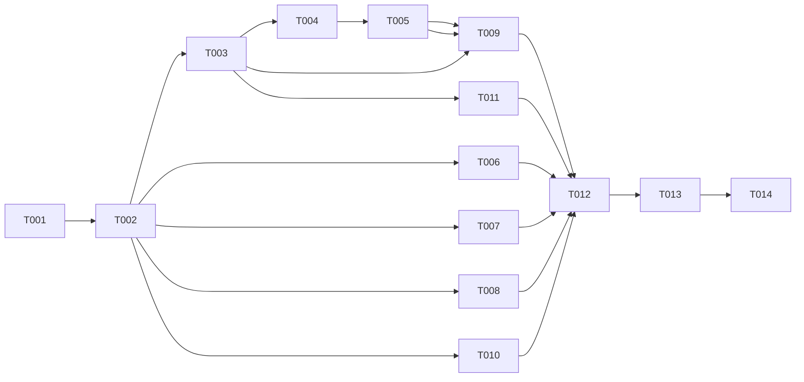

# Tasks: GL Account Maintenance and Inquiry

**Input**: `specs/001-gl-account-maintenance/` (spec.md, plan.md, data-model.md, research.md, quickstart.md, contracts/openapi.yaml, ux/)

**Prerequisites**: specification, clarification, architecture, api_contract and ux stages approved. This file is the `task_decomposition` stage.

**Tests**: Required. Evidence rule (`AGENTS.md`): tests are derived from acceptance criteria. Every slice task writes its own unit and integration tests and puts each AC ID in a test name or comment so `sdlc.cs traceability` can derive coverage. The contract (`contracts/openapi.yaml`) is authoritative (ADR-001); implementation conforms to it and never the other way round.

**Data layer**: stub data only. In-memory, thread-safe, deterministic, synthetic. No database, ORM, migrations, connection strings or generic `IRepository<T>`. Say "stub data only", never "persisted".

**Authentication and authorization**: none in this phase (Q-001). Do not add any. `X-User-Id` is an optional, unverified audit identifier (A-008).

## Format: `- [ ] T### [P?] [Story] Description with path`

- **[P]**: can run in parallel with other [P] tasks of the same phase (different files, no dependency on an incomplete task). In this repository slices are implemented **one task at a time** with approval before each, so [P] documents independence only.
- **[US#]**: spec user story (US1 = US-AM-001 ... US12 = US-AM-012).
- Task IDs map to traceability IDs: `T003` is `TASK-GLA-003`.
- Mark `[X]` only when `build` and `unit_tests` both exited 0 through `sdlc.cs evidence`.

## Story index

| Label | Spec story | Priority | Slice task |
|---|---|---|---|
| US1 | US-AM-001 Create with segment validation | P1 | T003, T004 |
| US2 | US-AM-002 Modify editable fields | P1 | T005 |
| US3 | US-AM-003 Classification | P1 | T003 |
| US4 | US-AM-004 Attributes | P2 | T009 |
| US5 | US-AM-005 Status | P1 | T004, T005 |
| US6 | US-AM-006 Groups | P2 | T010 |
| US7 | US-AM-007 Period summary | P1 | T007 |
| US8 | US-AM-008 Transactions | P1 | T008 |
| US9 | US-AM-009 Protected deletion | P1 | T006 |
| US10 | US-AM-010 COA validation | P1 | T003, T005 |
| US11 | US-AM-011 Audit trail (access control deferred) | P1 | T002, T003, T005, T009 |
| US12 | US-AM-012 Templates | P3 | T003, T011 |

---

## Phase 1: Setup

**Purpose**: create the projects. No application code exists yet (repository baseline).

- [X] T001 Create the solution and projects per plan.md "Source layout": `GlAccounts.sln` (use `dotnet new sln --format sln`), `src/GlAccounts.Api/GlAccounts.Api.csproj` (`net10.0`, minimal API web project, `Program.cs` with `public partial class Program`), `tests/GlAccounts.Api.UnitTests/` and `tests/GlAccounts.Api.IntegrationTests/` (xUnit; the integration project references `Microsoft.AspNetCore.Mvc.Testing`). Add `Directory.Build.props` with `<Nullable>enable</Nullable>`, `<ImplicitUsings>enable</ImplicitUsings>`, `<TreatWarningsAsErrors>true</TreatWarningsAsErrors>`. Add `.gitignore` entries for `bin/` and `obj/` if missing. Do not add FluentValidation, MediatR, an ORM or any auth package. Done when `dotnet build --no-restore -warnaserror` and `dotnet test --no-build` exit 0 on the empty projects (first `dotnet restore`). Requirements: none directly (plan "Technical Context"). Record both runs with `sdlc.cs evidence`.

**Checkpoint**: solution builds with zero warnings.

---

## Phase 2: Foundational (blocks every slice)

**Purpose**: shared domain, error mapping, audit, user-id, ETag and the complete seed data. Only what at least three slices share lives in `Common/` and `Domain/`.

- [X] T002 Implement the foundation in `src/GlAccounts.Api/` (plan "F0 Foundation"; requirements NFR-GLA-007, NFR-GLA-008, REQ-GLA-030/031 plumbing, D-01, D-02, D-04, D-10, D-11, D-12):
  - `Domain/`: `Account` (fields and constraints from data-model.md, quoted: accountId string <= 32 chars; description 1..200; accountType `Financial|Statistical`; category `Asset|Liability|Equity|Revenue|Expense` for Financial, `Statistical` for Statistical; currencyId `USD|EUR|GBP|JPY`; status `Active|Hold|Inactive|Template`; balanceType `BalanceForward|Periodic` and normalBalance `Debit|Credit`, required for Financial and not allowed for Statistical; createdDate; version token; derived `eligibleForPosting` true only for `Active`), `AccountAttribute` (attributeId, attributeTypeId, attributeValueId), `AccountId` parsing into three numeric segments of 4, 3, 2 digits joined by `-`, total <= 32, each segment checked against its seeded value list (segments named Main, Department, Sub), status rules (Active/Hold/Inactive free among each other, Template never changes to or from another status), category rules.
  - `Common/`: ProblemDetails mapping (`HttpValidationProblemDetails` for 400, `ProblemDetails` for 404/409/500, media type `application/problem+json`, no internal details in 500), `X-User-Id` reader (`unknown` when absent), ETag helper (opaque version token, strong ETag in quotes, `If-Match` compare), append-only `IAuditStore` + in-memory implementation with entry kinds `Created`, `FieldChanged`, `StatusChanged`, `AttributeAdded`, `AttributeChanged`, `AttributeRemoved` and fields auditId, accountId, kind, userId, timestamp, field, before, after, justification. **No read endpoint for audit**; expose a read method only on the test-visible store interface.
  - `Features/GlAccounts/StubData/`: deterministic seed data with fixed IDs and timestamps for every state in plan.md "Seed data states", including `1000-100-01` (Active Financial, created 2025-01-01, attribute `att-1` dept/finance and a second attribute, member of the nested groups `grp-revenue-na` under `grp-revenue`, balances over several periods and years of 2025 and an `Original` budget version; it is therefore not deletable), a separate dependency-free Active Financial account for the successful delete, `1000-200-01` with exactly 10,001 posted transactions (counts precomputed for the dependency check), `9000-100-01` Template, an account with only unposted transactions, accounts blocked by a budget, by an allocation, by a group, one with several blocker types, Hold, Inactive and Statistical accounts, an account in no group, an account without balances or transactions, the attribute catalog (types and values, e.g. `dept`/`finance`, `region`/`emea`), segment value lists (Main includes 1000, 3000, 6000, 9000; Department includes 100, 200, 300; Sub includes 01, 02, so the contract examples 1000-100-02 and 6000-100-01 are valid and unused, while 777 is not an allowed Department value), groups with parent chains. Stores are read-only for other-module data (Q-008) and thread-safe for accounts and audit.
  - `AddGlAccountsFeature` DI extension registering all stores (D-12); `Program.cs` maps nothing yet except the ProblemDetails pipeline.
  - Unit tests for `AccountId` parsing (valid, wrong segment count, length, separator, unknown value), category rules, status rules, eligibility, ETag helper, audit store append-only behaviour (NFR-GLA-007), and a test that scans seed data for real-looking names, emails or identifiers (NFR-GLA-008, synthetic only). Reference NFR IDs in test names.
  - Done when build (`-warnaserror`) and tests exit 0 via `sdlc.cs evidence`.

**Checkpoint**: foundation ready; slices can be implemented one at a time.

---

## Phase 3: US1 / US3 Create a GL account (Priority: P1, MVP)

**Goal**: create accounts from a full Account ID with classification validation.
**Independent test**: create one account with valid segments and read nothing else; repeat with an invalid segment, a duplicate and an invalid classification.

- [X] T003 [US1] Slice S01 CreateAccount in `src/GlAccounts.Api/Features/GlAccounts/CreateAccount/` (Endpoint, Command, Handler, Validator, Response) for `POST /api/gl/accounts` (operationId `createAccount`, API-GLA-001 / API-GLA-016 without the template path):
  - Requirements: REQ-GLA-001, 002, 003, 007, 008, 027, 030, 032. NFR-GLA-001 (<= 2 s) and NFR-GLA-006 (errors returned after submit; no validation-only operation).
  - Acceptance criteria to make testable: AC-GLA-001, 002, 003, 011, 012, 013, 043, 044, 049, 052, 057.
  - Behaviour (quote the contract): 201 with `Location` and `ETag` and an `Account` body (segments, `eligibleForPosting`, `attributes` empty); 400 `HttpValidationProblemDetails` with field-level errors: Account ID format message "Account ID does not match segment format. Expected format: {format}" naming each invalid segment; one actionable message per missing or invalid field; Financial requires balanceType and normalBalance; Statistical requires category `Statistical` and forbids both; 409 "Account ID '{id}' already exists. Please use a unique ID." (D-02); status `Template` creates a template (AC-GLA-052); audit `Created` with `X-User-Id` or `unknown` and a timestamp (AC-GLA-049). Validation runs in the handler path so a direct request is rejected exactly as through any client (AC-GLA-044).
  - The request type accepts `attributes` and `templateAccountId` as in the contract, but processing of those two fields belongs to T009 and T011. Until then they are not processed; this is a known incomplete state that ends when T009 and T011 are done, and the contract is not claimed as fully implemented before then.
  - Tests: unit (validator, handler) and integration (`WebApplicationFactory`, fresh seeded store per test) with AC IDs in names or comments.

**Checkpoint**: accounts can be created and rejected correctly.

---

## Phase 4: US1 / US5 Get an account (P1)

- [X] T004 [US1] [US5] Slice S02 GetAccount in `src/GlAccounts.Api/Features/GlAccounts/GetAccount/` for `GET /api/gl/accounts/{id}` (operationId `getAccount`, API-GLA-002):
  - Requirements: REQ-GLA-005, 013. NFR-GLA-002 (<= 1 s).
  - Acceptance criteria: AC-GLA-004, 005, 020, 021.
  - Behaviour: 200 with `Account` body and `ETag`; `eligibleForPosting` true only for status `Active`; for Hold, Inactive and Template it is false; 404 `ProblemDetails` "Account '{id}' was not found." with no data leaked; id longer than 32 characters returns 400.
  - Tests: unit and integration for each seeded status (Active, Hold, Inactive, Template) plus unknown ID.

**Checkpoint**: read-after-write works for created accounts.

---

## Phase 5: US2 / US5 / US10 / US11 Update an account (P1)

- [X] T005 [US2] [US5] [US10] [US11] Slice S03 UpdateAccount in `src/GlAccounts.Api/Features/GlAccounts/UpdateAccount/` for `PUT /api/gl/accounts/{id}` (operationId `updateAccount`, API-GLA-003); depends on T003 and T004:
  - Requirements: REQ-GLA-004, 006, 007, 008, 014, 031, 035. NFR-GLA-003 (<= 1 s).
  - Acceptance criteria: AC-GLA-006, 007, 008, 009, 010, 022, 023, 045, 050, 051 (status-change part), 056.
  - Behaviour: editable fields only: description (1..200), category (valid for the stored accountType), currencyId (`USD|EUR|GBP|JPY`, change always allowed), status. `If-Match` is required: missing returns 400, stale returns 409 "The account was changed by someone else. Reload it and try again." and leaves the stored account unchanged (D-04, AC-GLA-056). `accountId` or `accountType` in the body with a value different from the stored one returns 400 naming the field and changes nothing (AC-GLA-008, 045). A changed status needs `statusJustification` of 1..500 characters (else 400); Active, Hold and Inactive move freely; a change to or from `Template` returns 400 and leaves the status unchanged (AC-GLA-023). Balance type and normal balance are not updatable. 404 for an unknown account. Response 200 with the new `Account` and a new `ETag`. Audit: one `FieldChanged` entry per changed field with before and after (AC-GLA-050) and one `StatusChanged` entry with justification (AC-GLA-051); nothing is audited when the request is rejected.
  - `attributeChanges` is not processed here; T009 adds it.
  - Tests: unit and integration, including two updates with the same ETag (second returns 409, first change kept).

**Checkpoint**: accounts can be maintained safely under concurrency.

---

## Phase 6: US9 Protected deletion (P1)

- [X] T006 [US9] Slice S04 DeleteAccount in `src/GlAccounts.Api/Features/GlAccounts/DeleteAccount/` for `DELETE /api/gl/accounts/{id}` (operationId `deleteAccount`, API-GLA-004); depends on T002 seed counts:
  - Requirements: REQ-GLA-024, 025, 026. NFR-GLA-005 (dependency check <= 1 s, including the 10,001-transaction account). Business rules BR-FE-1-002, BR-BE-1-001, BR-GLA-011.
  - Acceptance criteria: AC-GLA-038, 039, 040, 041, 042.
  - Behaviour: one dependency check returns counts of posted transactions, unposted transactions, budgets, allocations and group memberships through a read-only store interface. All zero: 204 with no body and a later read returns 404. Any non-zero: 409 `DeleteBlockedProblemDetails` listing every non-zero blocker (`kind` one of `PostedTransactions`, `UnpostedTransactions`, `Budgets`, `Allocations`, `GroupMemberships`, with `count`), `detail` "Cannot delete account '{id}'. It has {N} posted transaction(s)." for posted transactions, and `suggestion` offering Inactive; the account still exists. 404 for unknown.
  - Tests: one per blocker type, several blockers together, success, and a timing test for the large seed account that avoids fixed sleeps.

**Checkpoint**: deletion is blocked correctly and quickly.

---

## Phase 7: US7 Period summary (P1)

- [X] T007 [US7] Slice S05 PeriodSummary in `src/GlAccounts.Api/Features/GlAccounts/PeriodSummary/` for `GET /api/gl/accounts/{id}/period-summary` (operationId `getPeriodSummary`, API-GLA-010) and `GET .../period-summary/export` (operationId `exportPeriodSummary`, API-GLA-011):
  - Requirements: REQ-GLA-017, 018, 019.
  - Acceptance criteria: AC-GLA-028, 029, 030, 031, 032.
  - Behaviour: periods, years and budget versions per the `PeriodSummary` schema; query `fiscalYear` filters all three lists, `sortBy` in `fiscalYear|fiscalPeriod|balance` (default `fiscalPeriod`), `sortDirection` `asc|desc`; invalid values return 400; account without balances returns 200 with empty lists; unknown account returns 404. Export returns an `.xlsx` workbook (`application/vnd.openxmlformats-officedocument.spreadsheetml.sheet`, `Content-Disposition`) with exactly the rows of the filtered and sorted view. Add the `ClosedXML` package (MIT) only in this slice (research.md); confirm it restores before using it.
  - Tests: integration for filter, sort, empty, 404, and an export test that opens the workbook and compares rows to the JSON response.

---

## Phase 8: US8 Transactions (P1)

- [X] T008 [US8] Slice S06 Transactions in `src/GlAccounts.Api/Features/GlAccounts/Transactions/` for `GET /api/gl/accounts/{id}/transactions` (`listAccountTransactions`, API-GLA-012), `GET .../transactions/{entryId}` (`getAccountTransaction`, API-GLA-013) and `GET .../transactions/export` (`exportAccountTransactions`, API-GLA-014):
  - Requirements: REQ-GLA-020, 021, 022, 023.
  - Acceptance criteria: AC-GLA-033, 034, 035, 036, 037.
  - Behaviour: envelope `{items,total,page,pageSize}`, `page` >= 1, `pageSize` default 50 and maximum 200 (larger returns 400), newest posting date first; filter by `fromDate`/`toDate` (inclusive, `toDate` not before `fromDate`) or by `fiscalYear` with `fiscalPeriod`; combining both kinds, or `fiscalPeriod` without `fiscalYear`, returns 400; empty account returns an empty page with 200; unknown account 404. Detail returns the `JournalEntryDetail` with lines; unknown entry 404. Export returns `text/csv` with header `entryId,batchId,description,amount,postingStatus,postingDate` and **all** matching rows (not one page); no match returns only the header.
  - Tests: default paging on the 10,001-entry account, filters, page size 201, detail, export equals filtered set.

---

## Phase 9: US4 Attributes (Priority: P2)

- [X] T009 [US4] [US11] Slice S07 ManageAttributes in `src/GlAccounts.Api/Features/GlAccounts/ManageAttributes/` for `POST /api/gl/accounts/{id}/attributes` (`addAccountAttribute`, API-GLA-005), `PUT .../attributes/{attributeId}` (`updateAccountAttribute`, API-GLA-006) and `DELETE .../attributes/{attributeId}` (`removeAccountAttribute`, API-GLA-007); also extends T003 and T005 for the staged paths; depends on T003 and T005:
  - Requirements: REQ-GLA-009, 010, 011, 012, 031. NFR-GLA-004 (<= 1 s).
  - Acceptance criteria: AC-GLA-014, 015, 016, 017, 018, 019, and the attribute part of AC-GLA-051.
  - Behaviour: attribute type and value must exist in the catalog and the value must belong to the type (400 field error otherwise; empty required field 400). Standalone operations change the account version (new `ETag` in the response). Staged: `attributes` on create and `attributeChanges` on update (`Add`, `Edit`, `Remove` rules per the `AttributeChange` schema) are applied with the account change, all or nothing; if any staged change is invalid nothing is applied and no audit entry is written (AC-GLA-018). Attributes never change `eligibleForPosting` (AC-GLA-019). Audit: `AttributeAdded`, `AttributeChanged`, `AttributeRemoved`, one entry per change.
  - Tests: add two, edit one, remove one, invalid value, staged success, staged failure rolls back (account fields and attributes unchanged), eligibility unchanged.

---

## Phase 10: US6 Account groups (Priority: P2)

- [X] T010 [P] [US6] Slice S08 ListAccountGroups in `src/GlAccounts.Api/Features/GlAccounts/ListAccountGroups/` for `GET /api/gl/accounts/{id}/groups` (`listAccountGroups`, API-GLA-008) and `GET .../groups/export` (`exportAccountGroups`, API-GLA-009):
  - Requirements: REQ-GLA-015, 016.
  - Acceptance criteria: AC-GLA-024, 025, 027.
  - Behaviour: each group has `groupId`, `name` and `parentChain` (nearest parent first, root last; empty for a root group); no group returns `{ "items": [] }` with 200; unknown account 404. Export returns `text/csv` with header `groupId,name,parentChain` (names joined by ` > `) and one row per group; none returns only the header.
  - Tests: nested groups, no group, export content, unknown account.

---

## Phase 11: US12 Templates (Priority: P3)

- [X] T011 [US12] Slice S09 Templates in `src/GlAccounts.Api/Features/GlAccounts/Templates/` for `GET /api/gl/accounts` (`searchAccounts`, API-GLA-015) and the template path of `POST /api/gl/accounts` (`createAccount` with `templateAccountId`, API-GLA-016); extends T003; depends on T003:
  - Requirements: REQ-GLA-033, 034 (REQ-GLA-032 is covered by T003).
  - Acceptance criteria: AC-GLA-053, 054, 055.
  - Behaviour: search with `q` (Account ID or description, case-insensitive), `status`, `accountType`, `category`, `page`, `pageSize` (default 50, maximum 200) returning `AccountSummaryPage`; `status=Template` is the template library. Create from template copies description, accountType, category, currencyId, balanceType, normalBalance from the template unless the request supplies them, default status `Active`, assigns its own full Account ID, leaves the template unchanged (AC-GLA-053); unknown template returns 404; a source that is not a template returns 400 saying the source is not a template (AC-GLA-054). Template accounts are not eligible for transactions (already covered by T004).
  - Tests: search matches only, create from template, non-template source, template unchanged afterwards.

---

## Phase 12: Polish and cross-cutting

- [X] T012 Contract conformance tests in `tests/GlAccounts.Api.IntegrationTests/Contract/`: for every operation in `contracts/openapi.yaml` call the running test host and check status codes, response schemas, content types and headers (`ETag`, `Location`, `Content-Disposition`) against the committed contract; run `dotnet run scripts/sdlc/sdlc.cs -- drift` against the contract generated by the app (if generation is not wired, record `contract_drift` as "not run (reason)", never as passed). Use `/sdlc-generate-tests`. Covers all 16 operations; reference the API IDs.
- [X] T013 NFR timing tests in `tests/GlAccounts.Api.IntegrationTests/Performance/`: NFR-GLA-001 (create <= 2 s), NFR-GLA-002/003/004 (read, update, attribute operations <= 1 s), NFR-GLA-005 (dependency check <= 1 s on the 10,001-transaction account). Generous ceilings, no fixed sleeps, each test labelled "stub data only". Use `/sdlc-generate-tests`.
- [X] T014 Traceability and quickstart: run the 18 scenarios in `quickstart.md`, make sure every active AC (AC-GLA-001..057 except the retired 026, 046, 047, 048) is referenced by at least one test, then `dotnet run scripts/sdlc/sdlc.cs -- gate specs/001-gl-account-maintenance traceability`. Fix gaps with additional tests only; do not edit the spec to shrink the set.

---

## Phase 13: Frontend (ADR-002: Angular + Angular Material, `src/GlAccounts.Web/`)

Added after the backend tasks, once ADR-002 was accepted. The UI only consumes the existing API; it does not change `contracts/openapi.yaml`. No authentication (Q-001). Unit tests are co-located `*.spec.ts` files that put AC IDs in test names or comments. Screens and states follow `ux/user-flows.md` and `ux/component-map.yaml`; every screen implements loading, empty, populated and error states (`forbidden` stays reserved and unreachable). Say "stub data only", never "persisted".

- [X] T015 [UI] Scaffold `src/GlAccounts.Web/` with Angular CLI (standalone components, strict TypeScript, routing, SCSS) and Angular Material; add `proxy.conf.json` sending `/api` to `http://localhost:5000`; app shell with navigation (Accounts search, Templates), lazy-loaded feature routes (`/gl/accounts/...`, `/gl/account-templates`); typed API client service for all 15 operations using the contract field names; a shared `ProblemDetails` model and error mapper (400 field errors, 404, 409, 500); ETag/`If-Match` helper; the `gap` wrappers shared by several screens (`PageHeader`, `EmptyState`, `ErrorBanner`, `StatusBadge`, `DescriptionList`) with `aria-live` regions per `user-flows.md`. Unit tests for the API client and error mapper. Gate: `npm run build` and `npm test` exit 0. Requirements: NFR-GLA-006 (errors after submit).
- [X] T016 [UI] [US1] [US5] [US6] [US9] Account search entry, account inquiry (UX-GLA-002) and delete dialog (UX-GLA-004) at `/gl/accounts/{id}`: classification, status, posting eligibility text (not colour alone), segments, attributes, groups panel with empty state and CSV export (API-GLA-008, 009), links to Edit, Period Summary, Transactions, Delete; delete `alertdialog` with focus trap, 204 success redirect, 409 `BlockerList` with counts and "Set status to Inactive instead" opening the edit form. Acceptance criteria: AC-GLA-004, 005, 020, 021, 024, 025, 027, 038, 039, 040, 041, 042. Depends on T015.
- [X] T017 [UI] [US1] [US2] [US4] [US5] Create/edit form (UX-GLA-001) with attribute panel (UX-GLA-003) at `/gl/accounts/new` and `/gl/accounts/{id}/edit`: Reactive Form, static Account ID format hint (4-3-2), Financial-only balance type and normal balance, Account ID and Account Type read-only on edit, justification field shown when status changes, save button disabled while in flight, field errors via `aria-describedby` and a `role="alert"` error summary after submit, 409 duplicate at the Account ID field, **409 stale version** with a Reload action that keeps the user's input, staged attribute changes sent as `attributeChanges` (Add/Edit/Remove) and immediate single-attribute calls on a saved account. Acceptance criteria: AC-GLA-001, 002, 003, 006, 007, 008, 009, 011, 012, 013, 014, 015, 016, 017, 018, 022, 023, 043, 044, 045, 056, 057. Depends on T015, T016.
- [X] T018 [UI] [US7] [US8] Period summary and transactions (UX-GLA-005) at `/gl/accounts/{id}/period-summary` and `/gl/accounts/{id}/transactions`: fiscal-year filter and sortable columns with `aria-sort`, balances by period and year plus budget versions, Excel export with the current filter and sort; transactions with default 50 rows, selectable page size up to 200, date range **or** fiscal period (mutually exclusive in the UI), row drill-down to the journal entry detail with lines, CSV export of the filtered set, result count announced ("50 of 10,001 entries"). Acceptance criteria: AC-GLA-028, 029, 030, 031, 032, 033, 034, 035, 036, 037. Depends on T015, T016.
- [X] T019 [UI] [US12] Template library (UX-GLA-006) at `/gl/account-templates`: search and filter (`status=Template`), paging, empty state, "Create account from template" with a new full Account ID and prefilled editable settings, 201 redirect to the new account, 400 for a source that is no longer a template, 409 duplicate and 400 invalid segments as in Flow 1. Acceptance criteria: AC-GLA-053, 054, 055. Depends on T015, T017.
- [X] T020 [UI] Browser tests in `src/GlAccounts.Web/e2e/` with Playwright and `@axe-core/playwright` against the running API (stub data, restarted per run) and the dev server: the 8 flows in `ux/user-flows.md`, keyboard-only paths for the form and the delete dialog, axe checks on the populated state of each screen (violations fail the test), the 409 stale-version path. Record `playwright` evidence only if the command really ran. Depends on T016 to T019.

**Checkpoint**: all gates ready for `/sdlc-run-gates` and `/sdlc-converge-feature`.

---

## Dependencies and execution order

- T001 then T002 are strictly first. T003 follows T002.
- T003 -> T004 -> T005 form the P1 account spine; T009 needs T003 and T005; T011 needs T003.
- T006, T007, T008 and T010 depend only on T002 (and on seed data) and can be done in any order after it; the order above follows priority.
- T012 to T014 need every slice done.

**Order of execution (one task at a time, approval before each):** T001, T002, T003, T004, T005, T006, T007, T008, T009, T010, T011, T012, T013, T014, T015, T016, T017, T018, T019, T020.

## Parallel opportunities (documentation only)

T006, T007, T008 and T010 touch different feature folders and could run in parallel by different developers after T002. T010 is marked [P] because it also shares no store method with the others.

## Implementation strategy

1. MVP: T001, T002, T003, T004 (create and read an account, with audit and validation).
2. Complete the P1 spine: T005, then T006, T007, T008.
3. P2: T009, T010. P3: T011.
4. Polish: T012, T013, T014, then `/sdlc-run-gates` and `/sdlc-converge-feature`.

After each task: `dotnet run scripts/sdlc/sdlc.cs -- evidence <spec-dir> build dotnet build --no-restore -warnaserror` then `evidence <spec-dir> unit_tests dotnet test --no-build`.

## Requirement coverage check

| Requirement | Task | | Requirement | Task |
|---|---|---|---|---|
| REQ-GLA-001, 002, 003 | T003 | | REQ-GLA-020, 021, 022, 023 | T008 |
| REQ-GLA-004 | T005 | | REQ-GLA-024, 025, 026 | T006 |
| REQ-GLA-005 | T004 | | REQ-GLA-027 | T003, T005 |
| REQ-GLA-006 | T005 | | REQ-GLA-028, 029 | deferred (Q-001) |
| REQ-GLA-007, 008 | T003, T005 | | REQ-GLA-030 | T002, T003 |
| REQ-GLA-009, 010, 011, 012 | T009 | | REQ-GLA-031 | T005, T009 |
| REQ-GLA-013 | T004 | | REQ-GLA-032 | T003 |
| REQ-GLA-014 | T005 | | REQ-GLA-033, 034 | T011 |
| REQ-GLA-015, 016 | T010 | | REQ-GLA-035 | T005 |
| REQ-GLA-017, 018, 019 | T007 | | | |

All 53 active acceptance criteria are assigned: AC-GLA-001..003, 011..013, 043, 044, 049, 052, 057 (T003); 004, 005, 020, 021 (T004); 006..010, 022, 023, 045, 050, 051, 056 (T005); 038..042 (T006); 028..032 (T007); 033..037 (T008); 014..019 (T009); 024, 025, 027 (T010); 053..055 (T011).

## Not tasked (decisions needed first)

- **Frontend implementation (UX-GLA-001..006).** ADR-002 is undecided; no UI task is created until a framework and component library are chosen and the 48 design-system gaps in `ux/component-map.yaml` are reviewed. Backend tasks do not depend on it.
- **Authentication and authorization** (REQ-GLA-028, 029): deferred by user decision (Q-001); needs its own feature, ADR and human approval.
- **Real database, migrations, durability**: out of scope; "not verified (stub data)".
